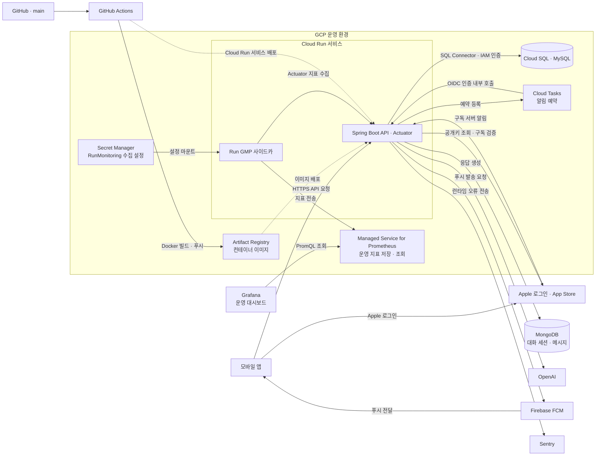

# Foryn

**대화와 일기, 복약 기록을 연결하는 ADHD·정서 지원 모바일 서비스의 백엔드**

실제 출시·운영한 모바일 서비스의 Spring Boot 기반 API 서버입니다. 사용자가 자신의 감정을 대화와 한줄일기로 기록하고, 복약 계획과 알림으로 일상 루틴을 관리할 수 있도록 돕습니다. Apple 로그인부터 AI 대화, 기록·리포트, 푸시 알림, App Store 구독까지 모바일 서비스에 필요한 기능을 제공합니다.

[주요 기능](#주요-기능) · [담당 역할](#담당-역할) · [운영 구조](#출시-당시-운영-구조) · [주요 설계와 검증](#주요-설계와-검증) · [상세 문서](docs/README.md)

## 주요 기능

| 기능 | 제공하는 경험 |
| --- | --- |
| AI 대화 | 사용자 상황과 감정에 따른 단계형 대화, 행동 기술 기반 응답, 대화 이력 조회 |
| 한줄일기 | 오늘·과거 날짜의 초안 작성과 완료, 공감 코멘트·태그 기록 |
| 복약 관리 | 복약 계획과 기록, 주간·월간 복약 리포트 |
| 감정 리포트 | 대화·복약·일기 자료를 바탕으로 기간별 감정 변화와 요약 제공 |
| 알림 | 기기 토큰 관리, 복약·일기 알림 설정과 예약, FCM 푸시 발송 |
| 로그인·구독 | Apple 로그인, JWT 발급·재발급·로그아웃, App Store 구독 검증·서버 알림 처리 |

위 표는 공개 소스가 제공하는 기능 범위입니다. 출시 버전별 세부 정책과 현재 구현은 다를 수 있으며, 현재 동작과 제약은 [기능별 설명](docs/README.md#기능별-설명)에서 확인할 수 있습니다.

## 담당 역할

| 구분 | 담당 범위 |
| --- | --- |
| 백엔드 개발 | 채팅, 한줄일기, 사용자 기능의 로그인·구독 개발 |
| 운영 | 서비스 운영 전반 |

출시 당시 운영 인프라와 현재 공개 소스에 반영된 설계·검증을 아래에 정리했습니다.

## 기술 스택

| 영역 | 기술 |
| --- | --- |
| 서버 | Java 21, Spring Boot, Spring Security |
| 데이터 | Spring Data JPA, Cloud SQL for MySQL, Spring Data MongoDB, MongoDB, Flyway |
| AI | Spring AI, OpenAI |
| 인증·결제 연동 | Apple 로그인, JWT, App Store API·JWS |
| 비동기 작업·푸시 | GCP Cloud Tasks, Firebase Cloud Messaging |
| 외부 API 클라이언트 | Spring Cloud OpenFeign |
| 캐시 | Spring Cache, Caffeine — Apple 공개키 캐시 |
| API 문서 | springdoc-openapi, Swagger UI |
| 운영 관측 | Actuator, Micrometer, Run GMP 사이드카, Google Managed Service for Prometheus, Grafana, Sentry |
| 빌드·배포 | Gradle, Docker, GitHub Actions, Artifact Registry |
| 운영 인프라·인증 | GCP Cloud Run, Cloud SQL Java Connector·IAM DB 인증, Cloud Tasks OIDC |
| 설정 관리 | GitHub Secrets·환경변수, Secret Manager의 지표 수집 설정 |
| 개발 서버 | EC2, Docker Hub |

테스트·검증 도구는 아래 [개발 소스의 검증](#개발-소스의-검증)에서 별도로 설명합니다.

## 출시 당시 운영 구조

원본 저장소에 남은 운영 배포 설정을 기준으로 정리한 구조입니다. 모바일 앱의 API 요청은 **GCP Cloud Run의 Spring Boot 서버**가 처리했습니다. 관계 데이터는 Cloud SQL의 MySQL에, 대화 세션·메시지는 MongoDB에 저장했습니다. 복약·일기 알림은 Cloud Tasks로 실행 시각을 예약하고 FCM으로 기기에 전달했습니다.



운영 배포는 **main 변경 → GitHub Actions의 Docker 이미지 빌드·푸시 → Artifact Registry → Cloud Run** 흐름으로 정의했습니다. Cloud SQL은 Java Connector와 서비스 계정의 IAM DB 인증으로 연결하고, Cloud Tasks의 서버 호출은 OIDC로 검증했습니다.

운영 지표는 **Actuator → 같은 Cloud Run 서비스의 Run GMP 사이드카 → Google Managed Service for Prometheus → Grafana**로 수집·조회했습니다. 사이드카의 `RunMonitoring` 설정은 Secret Manager에서 마운트했습니다. 독립 Prometheus 서버를 사용하는 로컬 관측 구성과 구분하며, 이 사이드카 구조는 [Google Cloud 공식 문서](https://docs.cloud.google.com/stackdriver/docs/managed-prometheus/cloudrun-sidecar)에서도 설명합니다.

Apple 로그인·App Store는 사용자 인증과 구독 검증에, OpenAI는 대화·일기 응답 생성에 사용했습니다. 런타임 오류는 Sentry로 추적했습니다. MongoDB와 Grafana의 배치 위치는 확인된 자료에 맞춰 특정 클라우드나 호스팅 제품으로 단정하지 않았습니다.

EC2·Docker Hub는 과거 개발 서버에 사용했습니다. 운영 서버의 Cloud Run·Cloud SQL 구성과 개발 환경을 구분했습니다. 상세 모듈 경계와 실행 환경은 [아키텍처](docs/ARCHITECTURE.md#실행-환경과-외부-연동)에 정리했습니다.

## 주요 설계와 검증

아래는 현재 공개 소스에 반영된 설계와 검증 방법입니다. **채팅 영속 복구·예약 Outbox와 장애 실험은 운영 종료 후 개발 소스에서 보완·검증한 내용**입니다. 출시·운영 당시 적용한 구조와 구분하며, 각 변경의 근거는 [설계 결정 이력](docs/ADR.md)에 기록했습니다.

### 1. 두 저장소에 걸친 채팅 저장과 복구 — 운영 종료 후 보완

대화 응답을 저장하면서 사용자 프로필도 변경하면 MySQL과 MongoDB에 함께 쓰게 됩니다. 한쪽만 저장되거나 커밋 응답이 유실되면 대화 단계와 사용자 상태가 달라질 수 있습니다.

메시지와 대화 단계는 MongoDB 트랜잭션으로 함께 처리합니다. 프로필 변경이 있는 경로는 **임시 대화 저장 → SQL 프로필·커밋 표시 저장 → 대화 확정**으로 나눴습니다. 영속 작업 기록을 기준으로 확정 또는 보상을 진행하며, 사용자별 작업권으로 동시 실행과 지연된 작업자를 제어합니다.

별도 장애 검사에서는 부분 저장, 커밋 후 응답 유실, 보상 실패와 JVM 종료 후 복구를 확인하도록 구성했습니다.

[저장 조정 코드](src/main/java/com/forA/chatbot/chat/service/ChatOperationService.java) · [복구 코드](src/main/java/com/forA/chatbot/chat/service/ChatRecoveryService.java) · [장애 검사 절차](docs/development/fault-tests/chat.md)

### 2. 날짜별 일기 상태와 감정 리포트의 기준 분리

과거 날짜의 일기를 작성할 수 있으면 기록 대상 날짜와 초안 만료 시각을 구분해야 합니다. 또한 초안을 완료할 때 같은 기록이 중복으로 생성되지 않아야 합니다.

일기는 사용자 시간대의 선택 날짜에 연결하고, 초안 만료는 마지막 수정 시각으로 판단합니다. 완료는 기존 기록의 상태 전환으로 처리합니다. 생성형 코멘트 호출이 실패하면 대체 문구를 사용합니다.

감정 리포트는 주간·월간의 자료 범위를 구분합니다. 완료 일기는 월간 감정 집계에 반영하고, 최근 이틀의 태그 요약은 사용자·조회일 기준으로 캐시합니다.

[일기 기능 설명](.cluedoc/journaling-and-insights/selected-date-diary/README.md) · [일기 트랜잭션 경계 테스트](src/test/java/com/forA/chatbot/diary/service/DiaryServiceTransactionBoundaryTest.java) · [감정 집계 설명](.cluedoc/journaling-and-insights/emotion-insights/README.md)

### 3. 복약 계획 저장과 외부 예약 등록의 분리 — 운영 종료 후 보완

DB에 복약 계획을 저장한 뒤 Cloud Tasks 등록이 실패하면 계획은 있지만 예약은 없는 상태가 생길 수 있습니다.

계획 변경과 **예약 의도인 Outbox를 같은 SQL 트랜잭션에 저장**하고, 커밋 이후 외부 등록을 시도합니다. 등록 실패와 처리 중단은 저장된 상태를 기준으로 재처리할 수 있게 했습니다. 계획·날짜·변경 버전별 Task ID와 발송 시 현재 버전 검사로 이전 예약의 실행을 제어합니다.

예약 등록 성공과 기기 수신 성공은 구분합니다. 발송 로그의 중복 방지 키와 처리권을 사용하며, 외부 푸시 성공 후 완료 기록 전에 중단되면 재전달될 수 있습니다.

[Outbox 처리 코드](src/main/java/com/forA/chatbot/notification/service/MedicationOutboxDispatcher.java) · [운영·복구 절차](docs/runbooks/medication-outbox.md) · [독립 프로세스 장애 검사](docs/development/fault-tests/outbox.md)

### 4. 리포트의 반복 조회와 DB 연결 점유 검증 — 로컬 재현·검증

날짜·세션별 반복 조회는 조회 횟수를 늘립니다. 여러 저장소를 읽는 리포트 전체에 SQL 트랜잭션을 유지하면 느린 MongoDB 조회 중에도 SQL 연결을 점유할 수 있습니다.

현재 감정 집계는 기간 단위로 자료를 조회하고 메시지를 배치로 읽어 날짜별로 계산합니다. 리포트 전체를 감싸는 SQL 트랜잭션을 두지 않고, 조회 구간별 시간을 계측합니다.

동일한 합성 자료에서 반복·배치 조회와 트랜잭션 유무를 조합한 네 비교군을 검사하도록 구성했습니다. 실제 연결 소유권, 조회 횟수, 일반 SQL 조회의 대기·실패를 함께 확인합니다. 이 로컬 통제 실험은 과거 운영 성능 수치와 구분합니다.

[감정 집계 코드](src/main/java/com/forA/chatbot/report/service/EmotionScoreCalculator.java) · [리포트 테스트](src/test/java/com/forA/chatbot/report/service/ReportServiceTest.java) · [연결 풀 비교 실험](docs/development/fault-tests/report.md)

## 개발 소스의 검증

JUnit 5·Mockito·AssertJ로 일반 테스트를 작성하고, 구조 검사·통합 테스트·장애 실험을 나눠 검증합니다. Checkstyle로 코드 스타일을 검사하고 JaCoCo로 커버리지 보고서를 생성합니다. ArchUnit은 Controller의 Repository 직접 의존과 계층·패키지 경계 위반을 검사합니다. GitHub Actions의 PR 워크플로에는 일반 테스트 실행을 정의했습니다.

```bash
./gradlew test lint archTest --no-daemon
```

Windows에서는 `./gradlew` 대신 `.\gradlew.bat`를 사용합니다. `integrationTest`와 장애 실험은 별도 실행 대상입니다. 준비 조건과 검사 범위는 [검증 안내](docs/development/testing.md)를 따릅니다.

로컬 관측과 k6 부하 검사는 개발 소스의 재현·검증 환경으로 제공합니다. HTTP 지연, JVM과 연결 풀 상태를 확인하는 방법은 [관측과 부하 확인](docs/development/observability.md)에 정리했습니다.

## 로컬 실행

현재 저장소는 운영 종료 후 운영 연결과 자격증명을 제거한 공개용 개발 소스입니다. 연결된 운영 환경과 자동 배포는 없습니다.

JDK 21과 Docker Desktop의 Linux 엔진이 필요합니다. MySQL·MongoDB·Prometheus·Grafana는 Docker Compose로, Spring Boot는 호스트 또는 IDE에서 실행합니다.

환경변수와 외부 연동 자격증명, Apple 공개 루트 인증서 준비는 [로컬 실행 안내](docs/development/local-setup.md)를 따릅니다.

## 문서 안내

| 목적 | 문서 |
| --- | --- |
| 제품 범위와 사용자 요구사항 | [PRD](docs/PRD.md) |
| 모듈·저장소·외부 연동 구조 | [아키텍처](docs/ARCHITECTURE.md) |
| 기술 선택과 트레이드오프 | [설계 결정 이력](docs/ADR.md) |
| 기능별 동작과 제약 | [기능 지도](.cluedoc/README.md) |
| 개발·검증·운영 절차 찾기 | [문서 안내](docs/README.md) |

현재 보완 범위인 인증·인가·로그 점검, 기능별 시간대 통일과 구독 이벤트 순서 처리는 [아키텍처의 현재 제약](docs/ARCHITECTURE.md#현재-제약)에 정리했습니다.

<details>
<summary>개발·협업 규칙</summary>

**📝 백엔드 협업 규칙**

**1. 커밋 컨벤션**

- "태그: 한글 커밋 메시지" 형식으로 작성 (ex. Fix: 로그인 API에서 NullPointerException 발생 문제 해결)
- 태그
    - **Feat** : 새로운 기능 구현
    - **Add** : feat 이외의 부수적인 코드 추가 및 라이브러리 추가, 새로운 파일 생성
    - **Mod** : feat 이외의 코드 수정 및 내부 파일 수정
    - **Rename** : 파일 혹은 폴더명 수정
    - **Del** : 사용하지 않거나 쓸모없는 코드나 파일, 폴더 삭제
    - **Fix** : 버그 및 오류 해결
    - **!BREAKING CHANGE** : 커다란 API 변경 (ex. API의 request, response 값의 변경, DB 테이블 변경)
    - **!HOTFIX** : 급하게 치명적인 버그를 고친 경우
    - **Style** : 코드 포맷팅, 세미콜론 누락, 오타 수정, 탭 사이즈 변경
    - **Refactor** : 프로덕션 코드 리팩토링, 새로운 기능이나 버그 수정없이 현재 구현 개선, 변수명 변경
    - **Test** : 테스트 추가, 테스트 리팩토링 (프로덕션 코드 변경X, test 폴더 내부의 변경)
    - **Design** : CSS 등 사용자 UI 디자인 변경
    - **Docs** : README나 WIKI 등의 문서 개정
    - **Chore** : 빌드 업무 수정, 패키지 매니저 수정 (프로덕션 코드 변경 X, package.json의 변경이나 dotenv의 요소 변경 등, 모듈의 변경)

**2. PR 템플릿**

본문은 저장소의 [PR 템플릿](.github/pull_request_template.md)을 사용합니다. 변경한 동작·이유와 실제 검증 결과를 기록합니다.

- PR 체크 리스트
    - PR 제목 형식 :`[Type] PR 제목`
        - ex.`[Feat] 회원가입 및 로그인 기능 개발`
        - 타입은 대문자로
    - label 설정
    - 작업자 자신을 Assign하고, Code Review 요청
    - 작성자 외 1명 확인 시 작성자가 merge

**3. issue 규칙**

- 이 복사본의 이슈·실행 계획은 [로컬 이슈 규칙](docs/AGENTS.md#로컬-이슈)에 따라 관리합니다.
- GitHub 이슈를 명시적으로 요청한 경우에만 `.github/ISSUE_TEMPLATE/`의 해당 템플릿을 사용합니다.

**4. branch 규칙**

- 브랜치 네이밍 규칙: `feature/(이슈번호)-(기능 이름)` ex. feature/11-user-login
- 같은 기능이더라도 수정사항이 생기면 새로운 브랜치 생성하기
- merge된 브랜치는 삭제하기
- `feature/* -> develop -> main`순으로 merge
- `feature/*`: 각 기능을 개발하는 브랜치
- `develop`: 각 기능의 개발을 완료하고 테스트 완료 후 병합하는 브랜치
- `main` : 배포되는 브랜치

</details>
